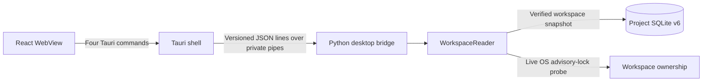

# Desktop architecture and IPC

The React WebView displays data. Rust owns the window, native picker, desktop library, and Python child. The Python Desktop bridge is a peer to CLI, TUI, and MCP. It calls a workspace reader that reuses the verified identity and canonical Task, Session, checkpoint, handoff, and lease logic. SQLite remains behind its existing adapter.



## Native commands

The local `main` window gets four application permissions. `library` reads registered entries, `open_project` picks an exact local folder and registers it after verification, `remove_project` removes a library entry, and `query` invokes a closed tagged read union. Rust supplies the expected project ID from the library. App config holds only pairs of canonical path and project ID. Theme preference is WebView-local. The library uses atomic replacement and a single app instance owns its writes.

The release WebView loads bundled assets with a restrictive CSP and an explicit navigation allowlist. New windows are denied. The development WebView also permits the fixed Vite loopback origin. Commands require no shell, filesystem, or external opener permission in the renderer. Record text is displayed without interpretation as HTML, links, or instructions. [Tauri IPC](https://v2.tauri.app/develop/calling-rust/), [Tauri capabilities](https://v2.tauri.app/security/capabilities/), [Tauri shell plugin](https://v2.tauri.app/plugin/shell/)

## Bridge version 1

UTF-8 newline-delimited JSON uses one request and one response per line. Each request has an integer `id`, `version: 1`, and `op`. Extra parameters are rejected. The reply echoes the ID and version and contains exactly one of `result` or an `error` with a stable `code` and human-readable `message`. Invalid or oversized frames without a valid ID receive a null ID. Stdout is reserved for frames. Internal stderr diagnostics contain no canonical payloads, and the native supervisor discards child stderr.

```json
{"version":1,"id":1,"op":"hello"}
{"version":1,"id":1,"result":{"protocol":1,"core_version":"0.1.0"}}
```

| Operation | Parameters beyond version, ID and operation | Result |
| --- | --- | --- |
| `hello` | — | Protocol and core version |
| `verify` | `root` | Verified name, path and ID. Rust uses this after the native picker. |
| `overview` | `root`, `project_id` | Identity, active Task, last Session, lease observation, unfinalized count, current work and latest checkpoint |
| `tasks` | Project binding, `offset` | Task previews and Session counts |
| `task` | Project binding, `task_id` | Task details and recorded checkpoint decisions |
| `objective` | Project binding, `task_id`, `offset` | Markdown source text and next Unicode character offset |
| `sessions`, `checkpoints`, `handoffs` | Project binding, optional `task_id`, `offset` | Bounded history page scoped to the project and optional Task |
| `checkpoint`, `handoff` | Project binding, `record_id` | Historical record and evidence |

History pages contain up to 20 records and a nullable next offset. Refresh returns a fresh observation and resets page offsets. Concurrent inserts can shift offset-based pages. Objectives use 8,192 Unicode characters per page. Detail lists show up to 16 entries of 400 characters each and disclose clipping. Requests are limited to 32 KiB and responses to 512 KiB. Every query revalidates the exact root and canonical Project identity. SQLite uses a short, read-only snapshot transaction with a 250 ms lock wait. SQLite can use WAL shared-memory files as part of concurrent reads.

## Lifecycle and authority

Rust starts the child on the first request and checks its handshake within 15 seconds. It serializes requests on the pipe, correlates replies by ID, and bounds outstanding callers to 16. An operation has an eight-second exchange deadline. Rust discards the owned bridge after transport failure, timeout, or a mismatched reply. Refresh can start a new child. App shutdown cancels outstanding callers and closes bridge stdin for cooperative exit before a bounded termination fallback. Python receives EOF if the pipe owner exits. Provider processes remain under their existing CLI lifecycle.

The live lock probe describes the whole workspace. An unfinalized Session is last-recorded state with uncertain process ownership. Exact resume indicates that current adapters and durable launch evidence support an exact ID. It is not a live check that the provider still has that conversation. Historical checkpoints and handoffs describe capture-time evidence, including recorded test provenance.
