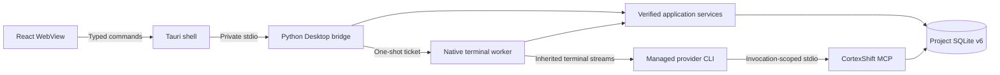

# Desktop architecture and IPC

The `main` window has seven local application permissions. `library`, `open_project`, and `remove_project` manage registered roots. `query` reads workspace and historical data. `create_task` streams an explicit Task objective. `agent_control` dispatches a closed command set. `pick_objective` reads a regular UTF-8 Markdown file selected by the native picker. Cancellation returns null. The picker returns a filename and text and accepts no renderer-supplied path.

Rust fills in the registered Project ID and, for terminal actions, the application-owned action directory. The renderer can select only a registered workspace and typed operation. The bundled WebView has a restrictive CSP and navigation policy. [Tauri IPC](https://v2.tauri.app/develop/calling-rust/) · [Tauri capabilities](https://v2.tauri.app/security/capabilities/)

## Bridge version 1

The existing UTF-8 JSON-line request envelope has a positive JavaScript-safe integer `id`, `version: 1`, and a known `op`. Extra fields are rejected. The response contains the same ID and version and exactly one of `result` and `error`. Identifiers are bounded ASCII. Workspace actions revalidate the exact canonical root and Project ID on every request. Request headers are bounded to 32 KiB and responses to 512 KiB. Stdout carries protocol responses. Internal diagnostics use sanitized stderr.

| Operation | Additional parameters | Result and validation |
| --- | --- | --- |
| `hello` | — | Protocol and core version |
| `verify` | `root` | Verified name, path, and ID from the native folder picker |
| `overview` | Project binding | Workspace activity, active Task, latest Session, progress, and checkpoint |
| `tasks`, `sessions`, `checkpoints`, `handoffs` | Project binding, `offset`, optional Task filter for histories | Up to 20 records and next offset |
| `task`, `objective` | Project binding, `task_id`, `offset` for objective | Task detail or up to 8,192 Unicode characters |
| `session`, `checkpoint`, `handoff` | Project binding, `record_id` | Scoped invocation or historical record with receipts |
| `create_task` | Project binding, `task_id`, `title`, `activate`, `expected_active`, `objective_bytes` | The header newline is immediately followed by exactly the declared number of UTF-8 bytes. Bounds follow SQLite's default length ceiling. `task_id` is a randomly allocated `task_` ID with 32 lowercase hex digits. Repeating a creation with the same identity and canonical input returns the saved Task. Replacement compares the observed active pointer inside the write transaction. |
| `activate_task` | Project binding, `task_id`, `expected_active` | Activates an eligible Task if the observed pointer still matches |
| `providers`, `provider_setup` | Project binding, optional operation-specific `provider` | Local executable and terminal availability, or a passive native CLI sign-in status probe for Claude Code or Codex |
| `plan` | Project binding, typed `action` | Redacted provider, mode, source and destination CortexShift Session IDs, and bootstrap-turn requirement |
| `submit` | Project binding, typed `action`, reviewed `plan`, 32 lowercase hex digit `operation_id`, native `control_dir` | One-shot ticket and pending receipt. Repeating the current operation ID returns its receipt. The worker rechecks the plan before invoking the core. |
| `action_status`, `cancel_action` | Project binding, native `control_dir`, `action_id` for cancellation | Latest receipt. Cancellation succeeds only before a worker claims the ticket. |
| `recover` | Project binding, `preview` | Project-wide eligible, reconciled, and uncertain counts. Execution is explicitly confirmed and the service rechecks ownership. |

Actions have one of four kinds: start, switch, resume, or continue. All pin the active Task. Start and switch identify a Claude Code or Codex destination. Switch and resume can reference an earlier CortexShift Session from the same Task. Continue requests a fresh conversation and may reference its historical source Session. Core selection determines native resume eligibility. No native provider session IDs or credentials cross the WebView IPC boundary.

## Terminal lifecycle

macOS opens a private executable `.command` file in the system Terminal using the absolute `/usr/bin/open` path. The wrapper contains only the quoted fixed sidecar invocation and ticket path. Windows starts the fixed sidecar executable with `CREATE_NEW_CONSOLE`. The development worker uses the configured workspace-independent Python interpreter. Search uses absolute Desktop PATH entries outside the project and standard installation paths on macOS. Windows looks for native `.exe` CLIs. [Apple Terminal](https://support.apple.com/guide/terminal/execute-commands-and-run-tools-apdb66b5242-0d18-49fc-9c47-a2498b7c91d5/mac) · [Windows process creation flags](https://learn.microsoft.com/en-us/windows/win32/procthread/process-creation-flags)

The worker takes an advisory ticket lock and consumes the request before launching. It verifies workspace identity, pinned Task, and current core plan. The application service takes the project's exclusive lease before the worker invokes a provider. The native process inherits the worker's terminal streams. Session finalization, process-exit evidence, retained-provider guard, checkpoint capture, and MCP authorization use the existing launcher. Closing Desktop stops the bridge only. Closing the native terminal interrupts the process according to OS and provider behavior.

The app-local ticket holds only action IDs, workspace identity, provider selection, and local search paths. Status retains the latest action's sanitized outcome. The lock distinguishes a claimed live job from a lost worker. If terminal dispatch does not reach a worker, the operator can cancel the pending ticket and choose a new action. A lost bridge response prompts an explicit state check. Desktop polls a bounded receipt and the OS lock while the window is visible. It refreshes relevant data on a change in phase or objective receipt.

Rust restarts the bridge after a transport or protocol failure. The handshake has a 15-second deadline, with an eight-second exchange deadline for ordinary requests and 12 seconds for the passive provider setup probe. Outstanding requests are bounded. Shutdown closes the bridge's stdin before a bounded termination fallback. The packaged worker can run the same fixed MCP server arguments as a Python install from its frozen entry point.

The 48,000 UTF-8 byte handoff budget and the invocation-scoped objective paging contract are preserved. Historical checkpoints, handoffs, and unfinalized Sessions keep their evidence semantics. [Desktop control ADR](../decisions/ADR-0020-desktop-agent-control.md)
